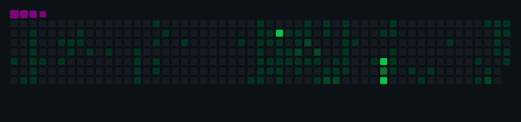

# Hi there 👋

I'm **古月** (guyue55) — a developer who enjoys building tools and exploring new technologies.

## 🐍 Contribution Snake

The snake eats my contribution graph daily! 🟩🍎

🎬 <strong>GIF Version</strong> (click to expand)

## 📊 GitHub Stats

  
  

## 🏆 GitHub Trophies

## 🔥 Streak Stats

## 🔧 Tech Stack

| Category | Technologies |
|----------|-------------|
| **Languages** | TypeScript, Python, Go, Rust, JavaScript |
| **Frontend** | React, Next.js, Vue, Svelte, Tailwind CSS |
| **Backend** | Node.js, Express, FastAPI, Gin, gRPC |
| **Infrastructure** | Docker, Kubernetes, Terraform, GitHub Actions |
| **Cloud** | AWS, GCP, Cloudflare, Vercel |
| **Databases** | PostgreSQL, Redis, MongoDB, ClickHouse |
| **Tools** | Git, VS Code, vim, tmux, zsh |

## 📈 Activity Graph

## 📫 Contact

- 🌐 GitHub: [@guyue55](https://github.com/guyue55)
- 📧 Email: guyue55@example.com
- 💬 Always open to interesting projects and collaborations!

---

  Built with ❤️ using GitHub Actions • Updated daily

---

*“凉凉月色，孤月残舞～！～”*
